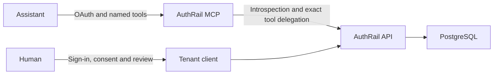

# AuthRail MCP architecture

The Go service connects assistants to AuthRail through named tools. The AuthRail
API owns identity, permissions, business rules and durable records. The tenant
client provides sign-in, consent and exact human review.

[API.md](API.md) lists implemented endpoints and tools. The shared product story
and plan describe the hosted MCP/A2A journey. The public listener exposes consented management, reviewed-tool discovery and
saved business-request tools. A separate private adapter and pinned standalone
gateway transport work after API-owned authorization.

## Ownership

| Component | Owns |
| --- | --- |
| AuthRail API | OAuth grants, live membership, domain permissions, draft changes, human decisions and audit records |
| MCP listener | Streamable HTTP, consent-based tool discovery and typed tool dispatch |
| Backend client | Fixed API paths, exact tool delegation, bounded calls and response identity checks |
| Tenant client | Human sign-in, organisation choice, consent, revocation and review |
| Local protected connector | Reviewed business-tool bindings, execution through the Go SDK and private recovery state |
| Sidecar | Published Rail verification and request/result evaluation |

## An assistant request

The assistant signs in and receives an OAuth token bound to one organisation and
the configured MCP resource. Each HTTP request asks the API to validate that token
against its source session, consent and live membership. The organisation comes
from this authenticated grant, never from tool arguments.

The listener exposes only consented tool groups. A tool exchanges the token for
a short-lived delegation bound to that exact named tool. The owning API endpoint
rechecks current authority and applies its normal business transaction. The Go
client verifies the returned user and organisation before disclosing the result.
The private service credential authenticates introspection and exchange; it
supplies no customer permission by itself.

Compliance configuration and verification each have separate read and preparation
consent. Typed tools call the existing Framework, Control, Test, Evidence, Finding
and readiness owners. Exact accepted scope and version references keep their
existing meaning. PostgreSQL retains draft commands with the owning mutation and
audit; current permission and object audience are checked before replay. A retry
returns the original saved references, while a fresh read shows later work.

Reserved human proof decisions, publication, scope acceptance and private file
transfer use actor/workspace-bound signed navigation to authenticated screens.
Opening a link applies nothing. The owning screen rechecks current authority and
shows the material the person is deciding on. Storage capabilities and retained
private files never pass through the public tool result.

The public transport is stateless. It does not retain workspace choices or
business execution state between requests. The resource is the canonical root origin `https://mcp.authrail.io`, without a
path or trailing slash. HTTP requests use `/` and metadata uses
`/.well-known/oauth-protected-resource`. Old `/mcp` grants remain distinct and
require reconnection; no token or consent is silently migrated.

Account management has separate `connections.manage` consent. The assistant
can find provider setup options and request a fixed AuthRail browser link.
The API checks live account-management permission; the person signs in and
completes provider consent, reconnect or disconnect. Link creation and page
opening do not change account access or disclose credentials.

Custom MCP is a connection option within the same product. Separate named tools
list saved server status and tool names or open an authenticated human handoff.
They never accept account tokens, server addresses or tool-publication authority
from an assistant. Exact schemas remain in the human review page and private API.

The private adapter's discovery operation initializes a public HTTPS server and
reads bounded tool pages using the account's own bearer access. It pins public
DNS, validates TLS and rejects redirects and destination changes. Before a Custom
business dispatch, it compares the current tool with the exact reviewed definition.
Changed or missing tools withdraw the original review; unavailable discovery stops
dispatch without claiming the business action failed. Server annotations grant no
authority, required task execution is unavailable, and no automatic provider retry
contract is inferred from MCP metadata.

## Authentication and transport

The API owns OAuth authorization codes, S256 PKCE, exact callbacks, opaque access
tokens and rotating refresh tokens. It supports registered clients, HTTPS client
metadata and bounded dynamic registration. Client registration does not grant
organisation access. Provider records live in PostgreSQL; one-use authentication
state uses Redis. Stored access tokens are hashed.

Delegations expire within one minute and do not outlive the source grant. They
are not browser or Runtime deployment credentials. Requests validate the listener
Host and browser Origin. Native clients may omit Origin. HTTPS is required except
for explicitly enabled loopback development.

API requests use fixed routes, deadlines, no redirects and a 64 KiB response
limit. Incoming management bodies are also bounded to 64 KiB. Errors exclude raw
backend bodies and credentials. Liveness says the process is serving requests;
it does not establish account access or protected execution.

## Drafts, decisions and history

Connected action continuation retains an exact predecessor and durable retry key
under the same action identity. History uses bounded numbered-version summaries;
exact reads retain immutable contracts. Retrying continuation returns its original
successor regardless of its later lifecycle, and only a draft receives a human
review link. Neither continuation nor review silently rebinds existing Rails or
deployments; unchanged retained protection renews against its exact saved binding.

Draft preparation uses the owning domain services, stable creation keys and
expected revisions. A conflicting save requires rereading and reconciling the
draft. Action and source drafts need human review; Rail drafts need exact human
publication. Contextual AI preparation runs through the API without exposing
model credentials to Go or customer configuration.

Policy, Data/source and Guard drafting use `runtime.drafts` consent for exact
reads, bounded history, continuation and human-review handoff. Domain permissions
and source audiences apply. Policy sources do not require Framework/Control setup.
Review links bind workspace, Rail/source, version and revision; the browser checks
that exact saved material, acknowledgement and confirmation before the API's
transactional publication path. Tools cannot publish or grant the human's authority.

Support tools require separate `support.reports` consent and named delegation.
The API derives reporter, workspace and assistant-client identity, then uses the
same SupportService as the UI. Only the reporter's submitted material/public status
is returned; no internal triage notes or Admin authority cross this boundary.
Unchanged submissions retain their UUID after uncertain responses. Staff email
and inbox delivery follow the report's committed outbox event.

Reserved deployment changes and approval decisions return signed, ten-minute
review proposals. Preparing a proposal changes no deployment or vote. Its browser
link binds the account, organisation, exact request and expected state. Only the
authenticated person can confirm it. Confirmation rechecks live permissions and
uses the owning domain transaction. Enforce confirmation includes the person's
protected-boundary assertion. Approval grants permission, not evidence of execution. A final hosted approval
atomically queues its linked saved request; the worker rechecks current authority
before continuation. A customer executor follows its own saved-request contract.

Reads use bounded projections and exact-version audience checks. Verification
history retains its Control or scoped Implementation owner. Missing, stale,
restricted or recalculating assessments remain unavailable. Connection health
reads use saved collection status and do not call providers. Tokens, provider
credentials, private assertions and application approval material are excluded
from ordinary tool results.

## Hosted evaluation and private dispatch

The private adapter accepts only an API-issued ticket for an existing saved
execution. The API derives the target, method, exact arguments and deadline from
that execution and a reviewed route bound to its Operation and account revision.
The gateway does not select an account from tool arguments. Collection credentials
alone do not create a reviewed business route.

The adapter synchronizes bounded routing configuration into a private Docker
volume. Upstream DNS results must be public and are pinned in the gateway's
backend configuration, with the original TLS server name and Host retained.
The volume also owns a persistent encrypted-session key. Every dispatch creates
its own client session; session state never substitutes for API authority.

ExtMCP request hooks recheck current authority and consume a one-use delivery
record before the business call. Handshake credentials also cover protocol
notifications that do not run request hooks. Response hooks retain exact encrypted evidence, a digest and the reviewed result-contract verdict;
the adapter reports transport and JSON-RPC failures separately because those do
not always run response hooks. Missing outcomes become unknown on the original
Action. Neither a response digest nor HTTP success authorizes result release.

A2A uses an explicitly reviewed A2A 1.0 recipient over JSON-RPC. The API wraps the
reviewed JSON business arguments in one data part, supplies the original attempt
as message ID and fixes the user role and nonblocking configuration. The adapter
validates those business arguments against the reviewed input schema before
permission consumption. Agent-supplied task IDs, destinations and credentials do
not select the recipient.

A returned task is retained with its original message, task and context references.
PostgreSQL owns task state, deduplicated observations and cancellation requests.
Bounded `GetTask` observations use a distinct delivery record and the original
reference. `CancelTask` requires separate reviewed cancellation access; one saved
cancellation delivery cannot become repeated sends. Input-required and auth-required
states remain interrupted work. Cancellation is not evidence that effects were
undone. A lost initial reply without a task reference remains unknown.

The supported subset uses same-origin manual HTTP bearer access and JSON inputs.
Files, streaming/push updates, tenant overrides, required extensions, text-only
skills, OAuth acquisition and multi-turn input submission are unsupported. Legacy routes are preserved and
require explicit 1.0 review for new hosted execution. A skill describes reviewed
intent; it does not isolate the recipient's internals. MCP hooks do not substitute
for A2A authorization.

The pinned private MCP hop negotiates `2025-11-25` with the gateway's stateful
listener. The management listener retains its own supported protocol versions.
Generated ExtMCP wire bindings come from the same published gateway tag; the
gateway implementation is not forked. Custom and native provider review publish private routes;
public discovery and business requests retain separate consent contracts.

The hosted path reuses the sidecar's Go evaluation engine. The API coordinates
that check and retains permission through one calling operation: resolve current
authority and versions, evaluate outside the database transaction, then recheck
and retain the decision/attempt atomically. The API does not evaluate Rails again.
Rule caches stay in sidecar memory; durable work belongs in PostgreSQL.

The private gateway adapter translates protocol requests/results into those
contracts and sends permitted work through agentgateway using the reviewed account
credential for external MCP/A2A targets. Native provider routes use the gateway
standard HTTP backend and an attempt bearer to one fixed private API endpoint;
account keys stay inside the API. It is not another agent or policy engine. Result checks precede
information release; execution outcomes are retained separately from permission.

Business response deadlines are one minute. An overdue attempt triggers provider
status reconciliation with its original identity, not a replacement write. Pending
human work stays saved; fresh facts and short-lived permits govern later execution.
Recovery schedules bounded original-reference checks fairly across tenants. Twelve
automatic claims exhaust the background allowance; explicit continuation can request
further checking. A failed task does not prove zero effects or allow another write.
The current local connector below still has its existing journal/expiry behavior.
The public `business.execute` tools retain caller-owned intent and an outbox event
in PostgreSQL. The outbox publishes a reference to the existing RabbitMQ jobs exchange;
a bounded consumer claims a leased, fenced request before execution. The dispatcher
never waits behind the business network call. A stable key reuses identical work; changed arguments or
bindings conflict. Pending human requests remain saved while later continuation
refreshes authority and facts. Exact human review includes the saved arguments and
review digest; superseded reviews retain their votes without transferring approval. Request reads never dispatch. Raw provider responses
stay encrypted until the reviewed result schema, result Rails and current caller
access allow release. A schema mismatch retains task/effect evidence and withholds
the result; it cannot erase an effect or authorize another write.

## Local protected execution

`authrail-protected-mcp` is a separate stdio command. Private operator configuration
binds one application principal/session, a fixed authenticated downstream server,
reviewed Operation versions, schema digests and resource ownership. Discovery is
input to review, not execution authority. Write bindings require a stable business
idempotency field that the downstream implementation actually honours.

The connector verifies the binding, resolves the resource and calls the Go SDK's
`Enforce` around the real downstream tool. The SDK coordinates Guard/Data/contextual
checks, approval permits and execution reports. Result checks run before disclosure.
Non-text content, interactive input requests and unreviewed shapes are withheld.
An execution report records what the connector reported, not independent proof of
the provider's effect.

Applications may use `ConnectManagedDownstream` with a fixed expected account and
an owner-supplied read-only identity verifier. Initial connection and explicit
`Refresh` verify the authenticated account, server compatibility and reviewed tool
schemas before replacing a session. A connector operation leases one session from
its resource/schema rechecks through dispatch; refresh returns busy while leased.
Failed refresh preserves the previous session and never repeats a business call.
The verifier's caller wait is bounded by its context and 30 seconds. A callback that
ignores cancellation still owns its work; only one unfinished verifier is retained,
late results are discarded and unused candidate sessions are closed. The owner
must bound and release any additional resources used by its verifier.

The legacy `ConnectDownstream` and stdio command retain their fixed-session
contract; generic MCP metadata cannot supply the required account proof. There is
no automatic credential reload for business dispatch. Customer API and resource
readers reread their private credential file on each read while retaining the fixed
account, endpoint, resource and principal checks. Managed downstream errors
distinguish HTTP rejection, missing session and uncertain transport; expiration or
revocation requires a trusted verifier fact. Refresh preserves the connector journal and pending work.

## Request recovery

An encrypted journal retains request arguments, reviewed bindings and approval
continuations. Exclusive process ownership, per-request locks and atomic synced
writes protect it. A durable marker precedes dispatch. Reusing a key with changed
arguments fails; replay does not repeat the tool or release cached output.

A waiting request checks exact approval status before claiming permission. A lost
claim response can recover only an existing unstarted, unexpired permit. Rejection,
expiry or an uncertain effect cannot start a replacement call. Trusted application
code may reconcile retained work using a provider lookup with the original business
identity. An agent cannot submit its own reconciliation claim.

Keep the journal, encryption key and sidecar state through upgrades. A crash at an
uncertain transition needs investigation; deleting state is not recovery. These
local files are not shared between replicas.

The connector library now offers an opt-in API-backed store. The owning application
supplies the API origin, deployment credential and executor key privately. Signed
commands claim a tenant-scoped key, compare revisions and fence expired owners.
Runtime encrypts the exact arguments and continuation in PostgreSQL. The Go SDK
checkpoints Action/attempt recovery before requesting a start; a single-use saved
dispatch marker must match the retained start before calling the tool. Its fixed
one-minute deadline also bounds the downstream call. Restart or lease takeover
cannot repeat that marker.

A worker marks overdue started work uncertain, including a saved checking
checkpoint whose start acknowledgement was lost. Trusted application code uses
`Connector.Reconcile` to check the original provider identity and retain its outcome;
the worker does not call providers or repeat writes. Pre-evaluation work without a
start remains available for inspection without automatic reevaluation. The shared
store and default local journal require the pinned checkpoint-capable Go SDK
source. New local records persist a versioned pre-start phase, advance before the
SDK start request, and advance again before downstream dispatch. Offline operator
inspection uses the same exclusive journal lock. Only proven pre-start interruptions
can be closed locally; legacy or possibly dispatched records remain unknown and
are never replayed. The operator command returns safe identity diagnostics without
arguments or results and does not accept provider-outcome assertions. No CLI shared-store flag or hosted
gateway dispatch is claimed. Gateway protocol sessions retain a separate routing
and recovery contract.

Provider credentials remain outside the agent's execution boundary. An equivalent
direct tool route can bypass the connector. The system must remove or block that
route before claiming enforcement; filesystem permissions alone do not contain
an unrestricted agent running as the same operating-system user.

## Native account setup

Separate named management tools list the selected providers, saved accounts and
review status. A management-consented assistant can open an authenticated human
page to connect, review, replace access or disconnect. These tools receive no
credentials and do not grant permission to execute business actions.

For a saved native dispatch, the adapter forwards the original parameter string
inside a bounded HTTP envelope, preserving exact JSON numbers. The API consumes
provider start once and interprets the real provider reply. The adapter retains
transport evidence and returns result_pending_check. The public business-request flow consumes these records and applies result
checks before release.

## Listener and resource configuration

The public assistant address is https://mcp.authrail.io. The listener accepts the
exact root path, publishes root protected-resource metadata and uses that exact
canonical origin as its OAuth resource/audience. Configuration rejects `/mcp`,
trailing slashes and other paths. Browser `/mcp/connect` remains the human consent
page; it is not the protocol endpoint. This local source does not establish a
public deployment.

The optional `business.tools.read` consent exposes two typed discovery tools.
The API derives organisation/user identity from exact named-tool delegation. The
Connections catalogue checks live account grants, selected credential generation,
reviewed operation contracts, active visible application revisions and current
source fingerprints before returning safe names or exact contracts. It does not
load credential ciphertext or contact a provider. Route IDs paginate bounded
pages; stale routes can yield an empty page with a continuation cursor. Discovery
is a current snapshot and never permission to execute. Business dispatch and result release require separate `business.execute` consent
and fresh Runtime authorization.

Consent selections are bound to signed request, user, session and organisation.
Changing that context clears optional choices and fences pending browser responses.
Legacy resource connections remain listed and revocable with reconnect guidance.

## Governance, account and human continuation

Organisation, Inventory, Activity, Policies/library/authoring, account and own notifications have separately selected domain scopes. Read consent never publishes management tools. Guide reads use workspace.read. Each typed registration fixes its API route and method; tool arguments cannot choose endpoints, identity or credentials. The API uses the same domain service and current permissions as the browser. Organisation lists carry small summaries; exact person reads page team memberships and role detail supplies full permission grants. Policy/content chunks bind the actor, workspace, tool and exact content revision. Incoming management and outgoing API responses retain their existing64KiB transport bounds; larger private edits/files continue in the authenticated application.

For an allowed mutation, PostgreSQL stores the stable command UUID and canonical input in the existing owning transaction after current permission/audience checks. The mutation, revision, audit and original outcome commit together. Concurrent duplicates return one original result; changed text under the same key conflicts. Policy commands retain original IDs/revisions/worker references instead of full documents, so retries cannot overwrite later edits or fill the ledger with content.

Reserved decisions, credentials and file capabilities stay in real human screens. A signed navigation link binds the user, workspace, fixed same-site destination and short navigation expiry. Opening it checks the current browser identity and active membership. Exact review flows additionally bind the record revision, require acknowledgement and preserve existing final confirmation. Links apply no values or grants. Their expiry does not expire a pending human approval request. MCP-created Inventory items remain unconfirmed until the human confirms them. An Activity entry is reported evidence; its attestation proves integrity, not an external business effect or independent review.
