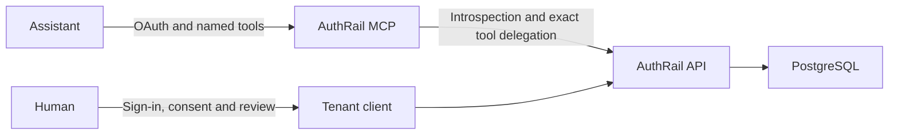

# AuthRail MCP architecture

The Go service connects assistants to AuthRail through named tools. The AuthRail
API owns identity, permissions, business rules and durable records. The tenant
client provides sign-in, consent and exact human review.

[API.md](API.md) lists implemented endpoints and tools. The shared product story
and plan describe the hosted MCP/A2A journey. The public listener serves
management tools. A separate private adapter and pinned standalone gateway
transport already-authorized work; the public listener does not yet expose
connected business-tool execution.

## Ownership

| Component | Owns |
| --- | --- |
| AuthRail API | OAuth grants, live membership, domain permissions, draft changes, human decisions and audit records |
| MCP listener | Streamable HTTP, consent-based tool discovery and typed tool dispatch |
| Backend client | Fixed API paths, exact tool delegation, bounded calls and response identity checks |
| Tenant client | Human sign-in, organisation choice, consent, revocation and review |
| Local protected connector | Reviewed business-tool bindings, execution through the Go SDK and private recovery state |
| Sidecar | Published Rail verification and request/result evaluation |

## An assistant request

The assistant signs in and receives an OAuth token bound to one organisation and
the configured MCP resource. Each HTTP request asks the API to validate that token
against its source session, consent and live membership. The organisation comes
from this authenticated grant, never from tool arguments.

The listener exposes only consented tool groups. A tool exchanges the token for
a short-lived delegation bound to that exact named tool. The owning API endpoint
rechecks current authority and applies its normal business transaction. The Go
client verifies the returned user and organisation before disclosing the result.
The private service credential authenticates introspection and exchange; it
supplies no customer permission by itself.

The management transport is stateless. It does not retain workspace choices or
business execution state between requests. The current resource uses `/mcp`.
Changing to the planned public root entry requires listener, OAuth resource,
audience, discovery and client settings to change together.

Account management has separate `connections.manage` consent. The assistant
can find provider setup options and request a fixed AuthRail browser link.
The API checks live account-management permission; the person signs in and
completes provider consent, reconnect or disconnect. Link creation and page
opening do not change account access or disclose credentials.

## Authentication and transport

The API owns OAuth authorization codes, S256 PKCE, exact callbacks, opaque access
tokens and rotating refresh tokens. It supports registered clients, HTTPS client
metadata and bounded dynamic registration. Client registration does not grant
organisation access. Provider records live in PostgreSQL; one-use authentication
state uses Redis. Stored access tokens are hashed.

Delegations expire within one minute and do not outlive the source grant. They
are not browser or Runtime deployment credentials. Requests validate the listener
Host and browser Origin. Native clients may omit Origin. HTTPS is required except
for explicitly enabled loopback development.

API requests use fixed routes, deadlines, no redirects and a 64 KiB response
limit. Incoming management bodies are also bounded to 64 KiB. Errors exclude raw
backend bodies and credentials. Liveness says the process is serving requests;
it does not establish account access or protected execution.

## Drafts, decisions and history

Draft preparation uses the owning domain services, stable creation keys and
expected revisions. A conflicting save requires rereading and reconciling the
draft. Action and source drafts need human review; Rail drafts need exact human
publication. Contextual AI preparation runs through the API without exposing
model credentials to Go or customer configuration.

Reserved deployment changes and approval decisions return signed, ten-minute
review proposals. Preparing a proposal changes no deployment or vote. Its browser
link binds the account, organisation, exact request and expected state. Only the
authenticated person can confirm it. Confirmation rechecks live permissions and
uses the owning domain transaction. Enforce confirmation includes the person's
protected-boundary assertion. Approval grants permission; it does not execute or
resume a business callback.

Reads use bounded projections and exact-version audience checks. Verification
history retains its Control or scoped Implementation owner. Missing, stale,
restricted or recalculating assessments remain unavailable. Connection health
reads use saved collection status and do not call providers. Tokens, provider
credentials, private assertions and application approval material are excluded
from ordinary tool results.

## Hosted evaluation and private dispatch

The private adapter accepts only an API-issued ticket for an existing saved
execution. The API derives the target, method, exact arguments and deadline from
that execution and a reviewed route bound to its Operation and account revision.
The gateway does not select an account from tool arguments. Collection credentials
alone do not create a reviewed business route.

The adapter synchronizes bounded routing configuration into a private Docker
volume. Upstream DNS results must be public and are pinned in the gateway's
backend configuration, with the original TLS server name and Host retained.
The volume also owns a persistent encrypted-session key. Every dispatch creates
its own client session; session state never substitutes for API authority.

ExtMCP request hooks recheck current authority and consume a one-use delivery
record before the business call. Handshake credentials also cover protocol
notifications that do not run request hooks. Response hooks retain a digest;
the adapter reports transport and JSON-RPC failures separately because those do
not always run response hooks. Missing outcomes become unknown on the original
Action. Neither a response digest nor HTTP success authorizes result release.

A2A uses a separate JSON-RPC route and the same private dispatch authority.
Current transport supports bounded `message/send`; streaming, task delegation
and interrupted-task continuation retain their own lifecycle. MCP hooks are not
applied to A2A as if the protocols were interchangeable.

The pinned private MCP hop negotiates `2025-11-25` with the gateway's stateful
listener. The management listener retains its own supported protocol versions.
Generated ExtMCP wire bindings come from the same published gateway tag; the
gateway implementation is not forked. Public root naming and customer tool
publication remain separate integration contracts.

The hosted path reuses the sidecar's Go evaluation engine. The API coordinates
that check and retains permission through one calling operation: resolve current
authority and versions, evaluate outside the database transaction, then recheck
and retain the decision/attempt atomically. The API does not evaluate Rails again.
Rule caches stay in sidecar memory; durable work belongs in PostgreSQL.

The private gateway adapter translates protocol requests/results into those
contracts and sends permitted work through agentgateway using the reviewed account
credential. It is not another agent or policy engine. Result checks precede
information release; execution outcomes are retained separately from permission.

Business response deadlines are one minute. An overdue attempt triggers provider
status reconciliation with its original identity, not a replacement write. Pending
human work stays saved; fresh facts and short-lived permits govern later execution.
The current local connector below still has its existing journal/expiry behavior.
These hosted contracts are intended work, not implemented management-listener tools.

## Local protected execution

`authrail-protected-mcp` is a separate stdio command. Private operator configuration
binds one application principal/session, a fixed authenticated downstream server,
reviewed Operation versions, schema digests and resource ownership. Discovery is
input to review, not execution authority. Write bindings require a stable business
idempotency field that the downstream implementation actually honours.

The connector verifies the binding, resolves the resource and calls the Go SDK's
`Enforce` around the real downstream tool. The SDK coordinates Guard/Data/contextual
checks, approval permits and execution reports. Result checks run before disclosure.
Non-text content, interactive input requests and unreviewed shapes are withheld.
An execution report records what the connector reported, not independent proof of
the provider's effect.

## Request recovery

An encrypted journal retains request arguments, reviewed bindings and approval
continuations. Exclusive process ownership, per-request locks and atomic synced
writes protect it. A durable marker precedes dispatch. Reusing a key with changed
arguments fails; replay does not repeat the tool or release cached output.

A waiting request checks exact approval status before claiming permission. A lost
claim response can recover only an existing unstarted, unexpired permit. Rejection,
expiry or an uncertain effect cannot start a replacement call. Trusted application
code may reconcile retained work using a provider lookup with the original business
identity. An agent cannot submit its own reconciliation claim.

Keep the journal, encryption key and sidecar state through upgrades. A crash at an
uncertain transition needs investigation; deleting state is not recovery. These
local files are not shared between replicas.

The connector library now offers an opt-in API-backed store. The owning application
supplies the API origin, deployment credential and executor key privately. Signed
commands claim a tenant-scoped key, compare revisions and fence expired owners.
Runtime encrypts the exact arguments and continuation in PostgreSQL. The Go SDK
checkpoints Action/attempt recovery before requesting a start; a single-use saved
dispatch marker must match the retained start before calling the tool. Its fixed
one-minute deadline also bounds the downstream call. Restart or lease takeover
cannot repeat that marker.

A worker marks overdue started work uncertain, including a saved checking
checkpoint whose start acknowledgement was lost. Trusted application code uses
`Connector.Reconcile` to check the original provider identity and retain its outcome;
the worker does not call providers or repeat writes. Pre-evaluation work without a
start remains available for inspection without automatic reevaluation. The shared
store requires checkpoint-capable Go SDK source; the currently pinned released SDK
continues to support the default local journal. No CLI shared-store flag or hosted
gateway dispatch is claimed. Gateway protocol sessions retain a separate routing
and recovery contract.

Provider credentials remain outside the agent's execution boundary. An equivalent
direct tool route can bypass the connector. The system must remove or block that
route before claiming enforcement; filesystem permissions alone do not contain
an unrestricted agent running as the same operating-system user.
